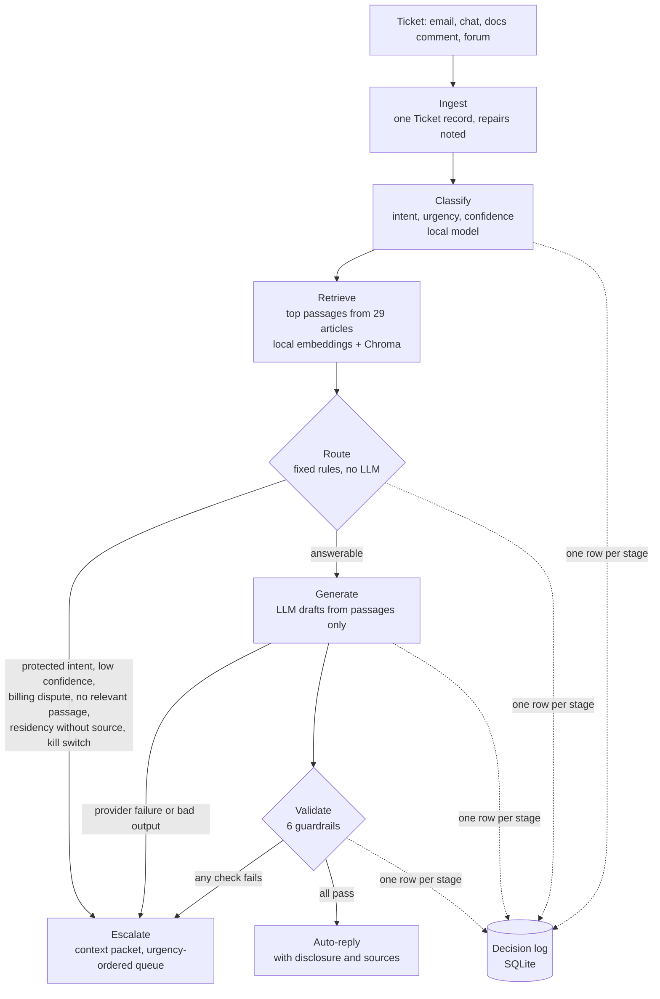

# Architecture

## What the system does

Every ticket, from any channel, goes through the same pipeline. If the help articles already
answer it and nothing about it needs a person, it gets a cited reply that says it was drafted by
an automated assistant. Otherwise it goes to a person with a context packet, and the escalation
queue is ordered by urgency and then age. Every decision is logged.

| Stage | Code | Runs where | Can it fail the ticket? |
|---|---|---|---|
| Ingest | `src/ingest.py`, `src/models.py` | local | No. Bad fields are repaired and noted in `ingest_warnings`. Unreadable records are counted and skipped. |
| Classify | `src/classify.py` | local | If it fails, the ticket escalates (`classifier_unavailable`). |
| Retrieve | `src/chunking.py`, `src/retrieve.py` | local | If it fails, the ticket escalates (`retrieval_unavailable`). |
| Route | `src/route.py` | local | Decides escalate or generate. |
| Generate | `src/generate.py`, `prompts/build/PR-01_generate.md` | OpenRouter | If it fails after retries, the ticket escalates (`generation_failed:*`). |
| Validate | `src/guardrails.py` | local | Any failed check blocks the draft (`guardrail_block`). |
| Act and log | `src/pipeline.py`, `src/logging_store.py` | local | — |
| Run a file | `evaluation/harness.py`, `evaluation/metrics.py` | local | Catches anything that escapes per ticket (`internal_error`). |
| Serve | `src/api.py`, `src/metrics_server.py` | local | A ticket problem never returns a 500. |

Only answer drafting depends on the network. If the provider is down, triage, routing, escalation
and logging all keep working.

## The routing rules, in order

The first rule that matches decides (`src/route.py`):

| # | Rule | Escalates when | Requirement |
|---|---|---|---|
| 0 | `empty_ticket` | The ticket has no text | FR-01 |
| 1 | `protected_intent` | Intent is security incident, compliance request, feature request or unclear request | FR-04 |
| 2 | `possible_protected_intent` | A protected intent is a runner-up with confidence ≥ 0.15 | FR-04 |
| 3 | `low_confidence` | Intent confidence < 0.80 | FR-05 |
| 4 | `billing_dispute` | A billing ticket explicitly contests a charge or asks for money back | FR-12 |
| 5 | `high_urgency_incident` | (Off by default.) High-urgency database or performance ticket | FR-09 |
| 6 | `residency_without_source` | A data-residency question without DOC-DATA-003 above the relevance threshold | FR-13 |
| 7 | `no_relevant_passage` | No passage scores ≥ 0.40 | FR-03 |
| — | `kill_switch` | The kill switch is on (checked in the pipeline after routing) | NFR-02 |
| 8 | `answerable` | Otherwise, a draft is generated | FR-06 |

## Key design decisions and the alternatives considered

| Decision | Chosen | Alternatives considered | Why |
|---|---|---|---|
| Who decides answer vs escalate | Fixed rules and thresholds | Ask the LLM whether it can answer | Marcus needs every decision explained at the compliance review, and the same ticket must always get the same route. An LLM verdict is neither deterministic nor calibratable. |
| Intent classifier | Sentence embeddings + logistic regression, trained on the 500 development tickets | Zero-shot LLM classification; fine-tuned transformer | Local, free, deterministic, works when the provider is down, calibratable. Out-of-fold accuracy was 99.8%, so a heavier model would add cost without benefit. |
| Calibration method | Plain multinomial logistic regression (C=64) | Sigmoid calibration on top (`CalibratedClassifierCV`) | The sigmoid layer reported 69% confidence on predictions that were right 99.8% of the time (30.5-point gap). Removing it gave a 2.6-point gap, inside the 5-point governance condition. |
| Chunking | One chunk per article section (116 chunks) | Fixed-size token windows; whole articles | Every article has the same four short sections. Section chunks are readable, cite precisely (`DOC-AUTH-004#resolution`) and never cut a step in half. |
| Search | Semantic embeddings (all-MiniLM-L6-v2) in Chroma | Keyword search (BM25) | Keyword search is the problem Ines described: "my deployment keeps dying" never finds "container health check failures". Semantic search ranks that article first. |
| Relevance threshold | 0.40 | 0.30–0.70 swept | Hit rate stays above 92% up to 0.45 and drops sharply at 0.50. The sweep also showed that no threshold reliably detects tickets with no matching article, so routing leans on intent rules for those. |
| Urgency | Predicted, used only to order the escalation queue | Use urgency in routing | Identical tickets carry different urgency labels (186 tickets in 67 groups), so urgency is about 50% predictable. It is too unreliable to decide whether a ticket gets an automated answer. |
| Answer drafting | One LLM call, JSON output, temperature 0, cached | Agent with tools; multi-step chain | The task is "rewrite these passages as a reply". One constrained call is cheaper, faster and easier to validate. |
| Guardrails | Deterministic rules on every draft | A second LLM as judge | Rules give the same verdict every time, cost nothing, and can be tested. An LLM judge would be another component that can hallucinate. |
| Billing disputes | A narrow keyword rule, plus a guardrail that blocks money promises | A broad rule catching "charges I don't recognise" | In the development data, 6 of the 8 copies of "charges for a service I do not believe we use" are labelled auto-respond, so the data treats them as invoice questions. The guardrail is the backstop. |
| Kill switch | A file checked on every ticket | Environment variable; config redeploy | Takes effect on the next ticket with no restart, can be operated by hand, and is testable. |

## Data and storage

| What | Where | Committed? |
|---|---|---|
| Ticket datasets, articles, reference answers | `data/` | Yes (small) |
| Document index | `storage/chroma/` | No: rebuilt on first run |
| Trained classifier | `storage/models/classifier.joblib` | No: trained on first run |
| LLM response cache | `storage/llm_cache.sqlite` | No |
| Decision log (API and demos) | `storage/decisions.db` | No |
| Decision log per evaluation run | `evaluation/results/<set>/decisions.db` | Yes, as evidence |
| Kill switch | `storage/KILL_SWITCH` (exists = on) | No |

## Thresholds and where they came from

| Setting | Value | Source |
|---|---|---|
| `CONFIDENCE_THRESHOLD` | 0.80 | `evaluation/results/classifier_sweep_dev.md`. Agreement with expected routes is flat from 0.30 to 0.85, so 0.80 is a safety margin with almost no coverage cost. |
| `RELEVANCE_THRESHOLD` | 0.40 | `evaluation/results/retrieval_sweep_dev.md` |
| `protected_margin` | 0.15 | Design choice: a protected intent that close behind is treated as a possibility to rule out, not to ignore. |
| `RETRIEVAL_TOP_K` | 5 | Default. Hit rate at k=5 is 93% on development data. |

All thresholds were set on development data only. The validation set was run afterwards and was
not used to change anything.
